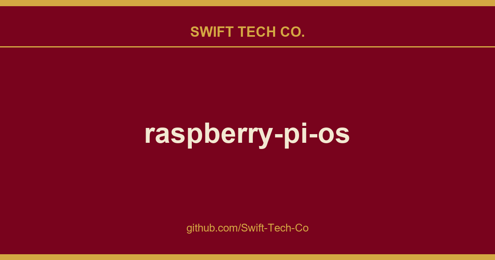

# raspberry-pi-os

## What This Is

We keep a working index for product and engineering, and raspberry-pi-os is the entry that collects our notes, examples and fixes. It reflects how Swift Tech Co. actually uses this in builds and client work.

## Images

## Table of Contents

* **[Introduction](docs/Introduction.md)**
* **[Contribution guide](docs/Contributions.md)**
* **[Prerequisites](docs/Prerequisites.md)**
* **Lesson 1: Kernel Initialization** 
  * 1.1 [Introducing RPi OS, or bare metal "Hello, world!"](docs/lesson01/rpi-os.md)
  * Linux
    * 1.2 [Project structure](docs/lesson01/linux/project-structure.md)
    * 1.3 [Kernel build system](docs/lesson01/linux/build-system.md) 
    * 1.4 [Startup sequence](docs/lesson01/linux/kernel-startup.md)
  * 1.5 [Exercises](docs/lesson01/exercises.md)
* **Lesson 2: Processor initialization**
  * 2.1 [RPi OS](docs/lesson02/rpi-os.md)
  * 2.2 [Linux](docs/lesson02/linux.md)
  * 2.3 [Exercises](docs/lesson02/exercises.md)
* **Lesson 3: Interrupt handling**
  * 3.1 [RPi OS](docs/lesson03/rpi-os.md)
  * Linux
    * 3.2 [Low level exception handling](docs/lesson03/linux/low_level-exception_handling.md) 
    * 3.3 [Interrupt controllers](docs/lesson03/linux/interrupt_controllers.md)
    * 3.4 [Timers](docs/lesson03/linux/timer.md)
  * 3.5 [Exercises](docs/lesson03/exercises.md)
* **Lesson 4: Process scheduler**
  * 4.1 [RPi OS](docs/lesson04/rpi-os.md) 
  * Linux
    * 4.2 [Scheduler basic structures](docs/lesson04/linux/basic_structures.md)
    * 4.3 [Forking a task](docs/lesson04/linux/fork.md)
    * 4.4 [Scheduler](docs/lesson04/linux/scheduler.md)
  * 4.5 [Exercises](docs/lesson04/exercises.md)
* **Lesson 5: User processes and system calls** 
  * 5.1 [RPi OS](docs/lesson05/rpi-os.md) 
  * 5.2 [Linux](docs/lesson05/linux.md)
  * 5.3 [Exercises](docs/lesson05/exercises.md)
* **Lesson 6: Virtual memory management**
  * 6.1 [RPi OS](docs/lesson06/rpi-os.md) 
  * 6.2 Linux (In progress)
  * 6.3 [Exercises](docs/lesson06/exercises.md)
* **Lesson 7: Signals and interrupt waiting** (To be done)
* **Lesson 8: File systems** (To be done)
* **Lesson 9: Executable files (ELF)** (To be done)
* **Lesson 10: Drivers** (To be done)
* **Lesson 11: Networking** (To be done)

---

## Swift Tech Co.

Built and maintained by Swift Tech Co.

AI Automation | FinTech Platforms | Custom Software and Mobile Apps | SaaS Platforms | Cloud Infrastructure | Cybersecurity | SEO and Marketing | API Integration

**Join our community on Telegram:** [t.me/+Qt_eFvkb2rliMzNh](https://t.me/+Qt_eFvkb2rliMzNh)

Home | Services | Careers | Referral Program | Influencers | About | Contact

**Connect**

- Website: https://github.com/Swift-Tech-Co/raspberry-pi-os
- LinkedIn: [linkedin.com/in/stephenoladoke](https://www.linkedin.com/in/stephenoladoke/)
- LinkedIn (Company): [linkedin.com/company/swift-tech-co](https://www.linkedin.com/company/swift-tech-co)
- X: [@MrOladoke](https://x.com/MrOladoke)
- Instagram: [@mr.oladoke](https://www.instagram.com/mr.oladoke/)
- Organization: [github.com/Swift-Tech-Co](https://github.com/Swift-Tech-Co)

## Sources

Compiled and maintained from upstream [s-matyukevich/raspberry-pi-os](https://github.com/s-matyukevich/raspberry-pi-os) under permissive open-source license.

---

Maintained by [Swift Tech Co.](https://github.com/Swift-Tech-Co) - [Telegram](https://t.me/+Qt_eFvkb2rliMzNh)

## Sources

Compiled and maintained from upstream [s-matyukevich/raspberry-pi-os](https://github.com/s-matyukevich/raspberry-pi-os) under permissive open-source license.

---

Maintained by [Swift Tech Co.](https://github.com/Swift-Tech-Co) - [Telegram](https://t.me/+Qt_eFvkb2rliMzNh)

## Sources

Compiled and maintained from upstream [s-matyukevich/raspberry-pi-os](https://github.com/s-matyukevich/raspberry-pi-os) under permissive open-source license.

---

Maintained by [Swift Tech Co.](https://github.com/Swift-Tech-Co) - [Telegram](https://t.me/+Qt_eFvkb2rliMzNh)